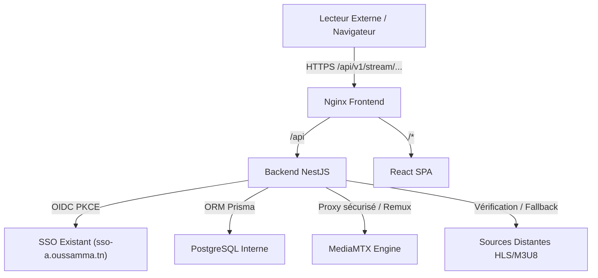

# IPTV Server — Documentation d'Architecture

## 1. Vue d'ensemble

IPTV Server est une plateforme complète et autonome d'agrégation, sécurisation, et distribution de flux multimédia légaux (HLS, RTSP, RTMP).

## 2. Composants

- **Backend NestJS** : Contrôleur d'API, orchestration Prisma, passerelle de streaming avec vérification dynamique de jetons (tokens).
- **PostgreSQL** : Stockage relationnel des comptes utilisateurs synchronisés via OIDC, catalogue de chaînes, sources vidéo avec priorité, et accès partagés.
- **MediaMTX** : Serveur RTSP/RTMP/HLS ultra-rapide en Go.
- **Frontend React / Vite / Tailwind** : Interface d'administration et lecteur intégré réactif desktop et mobile.
- **Authentification SSO** : Intégration OIDC avec découverte well-known, PKCE S256 et attribution automatique du rôle ADMIN pour l'administrateur initial.
